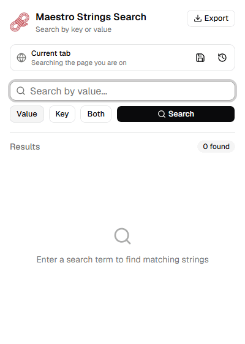
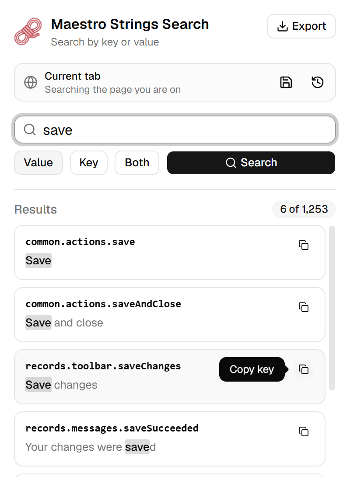
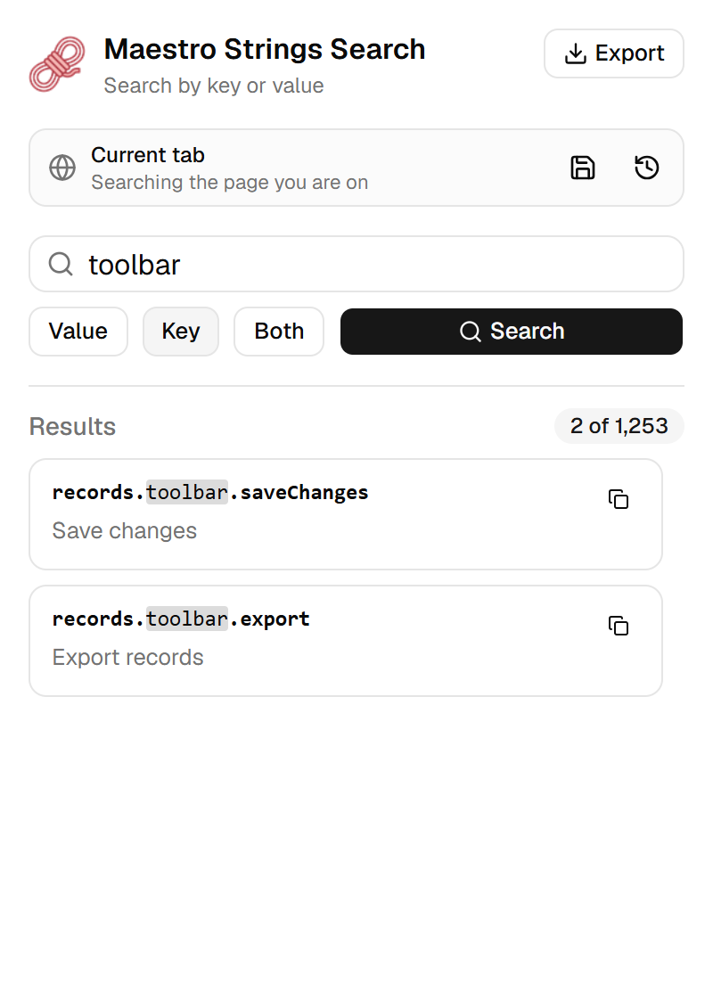
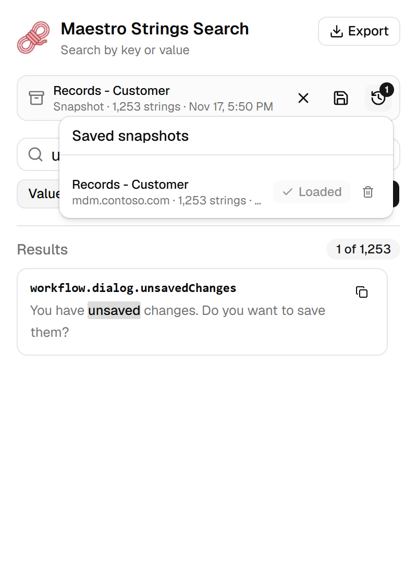
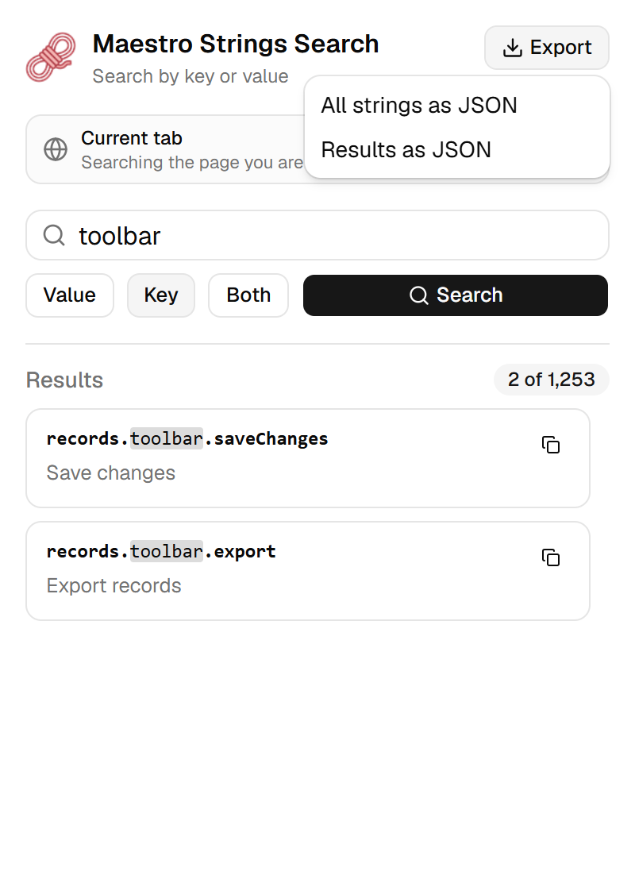
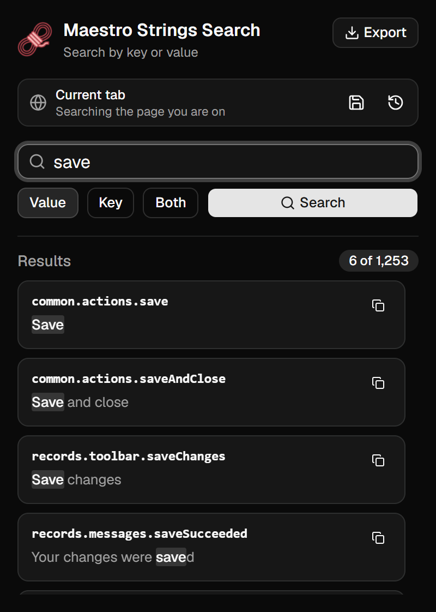

# Maestro Strings Search Extension

A Chromium extension that searches `window.maestroStrings` on the active page. Built with React, Vite, Tailwind CSS, and [shadcn/ui](https://ui.shadcn.com).



## Features

- Search by **Value**, **Key**, or **Both**.
- Copy a key with the copy button on each result.
- Save a snapshot of a tab's strings, then search it from any tab.
- Export to JSON: all strings, or the current results only.
- The popup keeps the last query, mode, and results after you close it.
- Large result lists stay fast, because the popup draws only the visible rows.
- The popup follows the system light or dark theme.

## Install

1. Download `maestro-strings-search-<version>.zip` from the [Releases](https://github.com/thuanvo-profisee/maestroStringSearch/releases) page.
2. Extract the zip to a folder.
3. Go to the extensions page:
   - Chrome: `chrome://extensions/`
   - Edge: `edge://extensions/`
   - Brave: `brave://extensions/`
4. Enable **Developer mode**.
5. Click **Load unpacked**, then select the folder from step 2.
6. Optional: pin the extension to the toolbar.

To update, extract the new zip to the same folder, then click **Reload** on the extension card.

## Use

### Search

1. Open a page that defines `window.maestroStrings`.
2. Click the extension icon.
3. Select **Value**, **Key**, or **Both**.
4. Type a search term, then press Enter or click **Search**.
5. To copy a key, click the copy button on the result.

The search is not case-sensitive. The badge shows the number of matches and the total number of strings.

| Search by value | Search by key |
|---|---|
|  |  |

### Snapshots

Use a snapshot to search strings from a page that is not open.

1. On a page that defines `window.maestroStrings`, click **Save snapshot** (disk icon). The popup saves the strings and loads the snapshot.
2. Go to a different tab and open the popup. The search uses the loaded snapshot.
3. To search the current tab again, click **X** in the source bar.
4. To see all snapshots, click **Saved snapshots** (clock icon). From the list, you can **Load** or delete a snapshot.

Snapshots stay until you delete them.



### Export

Click **Export**, then select one of these:

- **All strings as JSON**: all strings from the current tab, or from the loaded snapshot.
- **Results as JSON**: only the results of the last search.



### Dark Theme

The popup follows the system light or dark theme.



## Develop

### Prerequisites

- Node.js 22 or later
- A Chromium-based browser

### Build

```sh
npm install
npm run build
```

The build writes the extension to the `dist` folder. Load `dist` as shown in [Install](#install), steps 3 to 5.

To rebuild on each change, run `npm run dev`. After each build, click **Reload** on the extension card.

### Project Structure

| Path | Contents |
|---|---|
| `public/manifest.json` | Extension manifest. The build copies it to `dist`. |
| `public/icons/` | Extension icons. |
| `popup.html` | Popup entry page. |
| `src/App.tsx` | Popup UI and actions. |
| `src/components/snapshot-bar.tsx` | Search source and the list of saved snapshots. |
| `src/components/result-list.tsx` | Result list that draws only the visible rows. |
| `src/components/result-item.tsx` | One result with the copy button. |
| `src/components/ui/` | shadcn/ui components. To add one, run `npx shadcn add <component>`. |
| `src/lib/maestro.ts` | Reads and searches `window.maestroStrings` in the page. |
| `src/lib/snapshots.ts` | Saves, lists, loads, and deletes snapshots. |
| `src/lib/popup-state.ts` | Saves the popup state. |
| `docs/images/` | Pictures for this README. |

### Release a New Version

1. Change `version` in `public/manifest.json` and `package.json`.
2. Commit and push the change.
3. Push a tag that matches the version, for example:

   ```sh
   git tag v2.1.0
   git push origin v2.1.0
   ```

4. The **Release** GitHub Actions workflow builds the extension and publishes the zip on the Releases page. If the tag does not match the manifest version, the workflow stops.

## Permissions

| Permission | Use |
|---|---|
| `activeTab`, `scripting` | Read `window.maestroStrings` from the active tab. |
| `<all_urls>` host access | Run the search on any page that you open. |
| `storage` | Keep the popup state and the snapshots. |
| `unlimitedStorage` | Keep large snapshots. |

The extension does not send data to a server.

## Troubleshooting

- **Loading fails:** select the folder that contains `manifest.json`. For a local build, this is `dist`, not the project root.
- **"window.maestroStrings not found on this page":** the page does not define the strings, or it has not loaded them yet. Reload the page, or load a snapshot.
- **The popup shows old behavior:** rebuild, then click **Reload** on the extension card.
- **The browser asks to accept new permissions:** version 2 adds `storage` and `unlimitedStorage`. Accept them to keep the popup state and snapshots.
